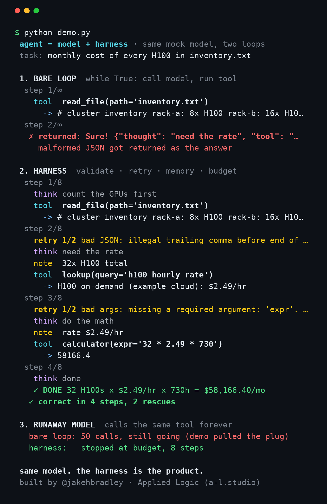
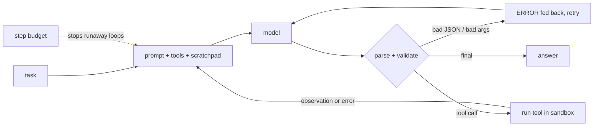

# tiny-harness

**agent = model + harness.** A ~300-line Python agent loop that shows why the loop around the model matters more than people think.



Same deterministic mock model, two loops:

- **Bare loop** trusts every reply. The model emits one sloppy JSON blob and the loop hands it back as "the answer".
- **Harness** validates every action, pushes errors back so the model can retry, keeps a scratchpad, and enforces a step budget. Same model, correct answer in 4 steps.
- **Runaway model**: the bare loop keeps calling the same tool until the demo pulls the plug. The harness stops at its budget.

It's a tiny demo, not a framework. The point is to make the harness something you can read in one sitting.

## Quickstart

```bash
git clone https://github.com/jakehb1/tiny-harness && cd tiny-harness
python demo.py          # zero dependencies, zero API keys
```

Use a real model with any OpenAI-compatible endpoint (OpenAI, xAI, OpenRouter, vLLM, Ollama…):

```bash
export OPENAI_API_KEY=...
export OPENAI_BASE_URL=https://api.openai.com/v1   # optional
export HARNESS_MODEL=gpt-4o-mini                   # optional
python run.py "What do the H100s in inventory.txt cost per month?"
```

With no key set, `run.py` falls back to the scripted mock.

## How it works



| piece | file | what it does |
|---|---|---|
| tool registry | `harness/tools.py` | `@tool` decorator; signature = schema; arg validation |
| example tools | `harness/tools.py` | `calculator` (AST, no `eval`), `read_file` (sandboxed to `sandbox/`), `lookup` (local KB, no web) |
| models | `harness/models.py` | `ScriptedModel` (offline, deterministic) and `OpenAIModel` (stdlib `urllib`) |
| loops | `harness/loop.py` | `bare_loop()` vs `Harness` (retries, validation, scratchpad, budget) |
| trace | `harness/trace.py` | colored step-by-step terminal trace (`NO_COLOR=1` to disable) |

## Add a tool

```python
from harness import tool

@tool
def gpu_count(rack: str):
    """Number of GPUs in a rack."""
    return {"rack-a": 8, "rack-b": 16, "rack-c": 8}.get(rack, 0)
```

That's it. The name, signature, and first docstring line go into the system prompt, and the harness rejects calls that don't match the signature before they run.

## Regenerate the image

```bash
pip install pillow
python scripts/render.py   # writes demo.png and demo.gif
```

## License

MIT. Built by [@jakehbradley](https://x.com/jakehbradley) · [Applied Logic](https://a-l.studio)
